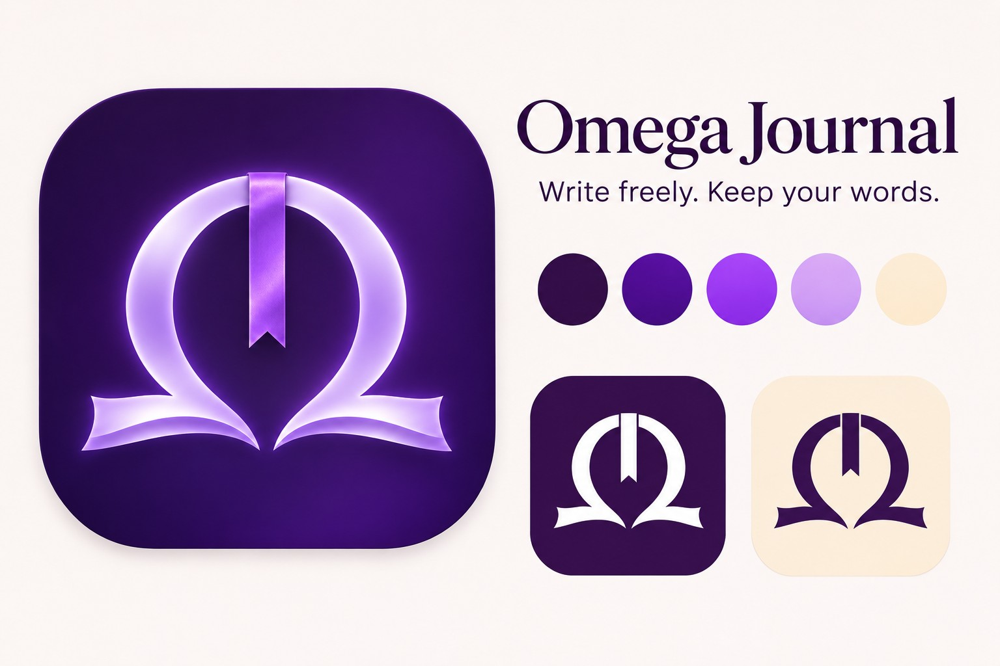

# Omega Journal brand

**Mark:** a Greek capital Ω whose feet open like the pages of a book, with a ribbon
bookmark hanging from the top of the arch. Journal (the book), keeping your place
(the ribbon), and the last word that's yours (Ω).

**Name:** "Omega Journal" — two words, both capitalized. Never "OmegaJournal" in prose.

**Lines:**
- "Write freely. Keep your words."
- "A private journal for your Mac."

**Colors** (sampled from the brand board):

| Name | Hex |
|------|-----|
| Midnight plum | `#320D47` |
| Deep violet | `#4F0C94` |
| Bright violet | `#9A37F1` |
| Lavender | `#D3A2F5` |
| Warm cream | `#FCEBD3` |

The app's default theme stays on its own tuned colors (accent `#9D6BFF`, background
`#1A0D2E`), which sit inside this palette.

**Files:**
- `packaging/AppIcon-1024.png` — app icon master (transparent, macOS 824px grid with
  shadow). `make_icon.swift` turns it into `AppIcon.icns` on every build; replace this
  PNG to change the icon.
- `docs/icon.png` — 512px icon for docs and the web.
- `docs/banner.jpg` — README / website header.

The artwork is raster (generated, Nov 2026). There is no vector source yet; redraw the
mark as a vector before printing it large.
